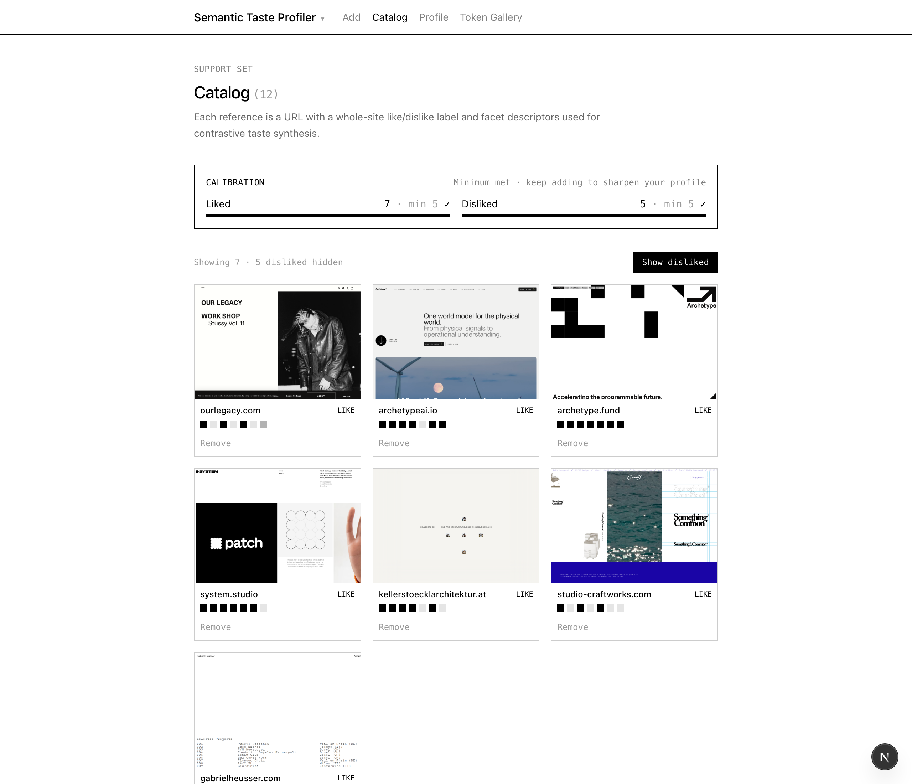

# Taste Profiler (POC)

A proof-of-concept for capturing a designer's personal taste from a small set of
liked and disliked references, then turning it into a plain-language profile an AI
design tool could follow.



## Credit

This project is based on **PseudoClient**, from:

> David Chuan-En Lin and Nikolas Martelaro. 2021. *Learning Personal Style from Few
> Examples.* In Designing Interactive Systems Conference 2021 (DIS '21).
> [doi:10.1145/3461778.3462115](https://doi.org/10.1145/3461778.3462115)

The paper shows that a model can learn someone's personal style from a handful of
positive and negative examples (5 liked + 5 disliked reached 79.4% accuracy in their
graphic-design experiments), learning by **juxtaposing** what appears in liked
examples against what appears in disliked ones. This project borrows that protocol but
points it at the **designer's own** taste rather than a client's, and produces a
semantic (written) profile instead of retrieving similar images.

## The three explorations

All three live in the same app; switch between them with the dropdown in the top nav.

### 1. Graphic Design Taste Profiler (`/graphic`)

Upload poster images. Claude (vision) writes a short, neutral descriptor for six
facets: color, typography, composition & layout, imagery & illustration style, form &
shape language, and texture & materiality. You edit the descriptors and score each
facet **Like / Neutral / Dislike** (+1 / 0 / −1).

### 2. Web Design Taste Profiler (`/web`)

The same idea applied to websites. Paste a URL; the app screenshots the landing page,
reads its HTML, and Claude describes seven web facets: hero composition, typography,
color, layout/grid, imagery style, motion/interaction, and CTA design. You score each
facet +1 / 0 / −1. A **Playground** then uses the resulting profile to generate
wireframes and UI token components that follow your taste.

### 3. Semantic Taste Profiler (`/web2`, the default)

A closer adaptation of the PseudoClient protocol. Instead of scoring every facet, you
mark each **whole site** as Liked or Disliked, building a support set. The catalog
tracks calibration toward the paper's 5 liked + 5 disliked minimum. Each reference also
gets an extracted design-token inventory (colors, type styles, icons, and CTAs with
hover/active/focus states captured from the live page), browsable in the **Token
Gallery**.

## How the taste profile is computed

**Explorations 1 and 2 (per-facet averaging).** Once at least 5 references exist, each
facet's scores are averaged across the catalog (a value from −1 to 1), and the
descriptors from references scored +1 and −1 on that facet are collected into liked and
disliked lists. Claude turns this into a 3–5 sentence profile, translating averages into
confidence and quoting concrete descriptor language rather than numbers.

**Exploration 3 (contrastive / juxtaposition).** Once the support set has 5 liked and 5
disliked sites:

1. Sites are split by whole-site valence into liked and disliked sets.
2. For each facet, descriptors from liked sites and from disliked sites are tokenized
   and word frequencies are counted per side.
3. A word becomes a **preferred signal** when it appears at least 2 more times in liked
   sites than in disliked ones (or appears 2+ times in liked and never in disliked);
   **avoided signals** are the mirror image.
4. Each facet gets an evidence strength based on how many descriptors back it, relative
   to the 10-example target.
5. This contrastive evidence is sent to Claude once, which writes a summary plus a
   per-facet *prefers / avoids* statement with a low/medium/high confidence.

In all three, the written profile is cached and only regenerated when the set of
references changes.

## Setup

Requires Node 18+ and an Anthropic API key.

```
npm install
npx playwright install chromium
cp .env.example .env.local
```

Set `ANTHROPIC_API_KEY` in `.env.local` to a secret key that starts with `sk-ant-`.

```
npm run dev
```

Open http://localhost:3000; it redirects to `/web2`. Data is stored locally as JSON
files in `data/` (gitignored), so each install starts with an empty catalog.
